# Fullproof Project Toolkit

**Build interview-ready projects.**

This is a Claude agent, not just a checklist you're supposed to follow on your own discipline. Point it at an idea or an existing project and it runs you through nine checkpoints - name the real risks, break what you built on purpose, verify it independently - before it will let you call anything "done." It's built from thirteen composable Claude skills: one umbrella skill that runs the whole agent as a single import, eight that cover one checkpoint at a time, and four more that route you to the right one, rehearse the live interview defense, audit a project you already have, and keep this repo's own methodology honest.

It's also the actual, phase-by-phase pipeline used to build two real, independently verified engineering projects (a flash-sale checkout backend with chaos-tested concurrency, and a data pipeline with chaos-tested correctness) - not generic "how to build a good portfolio project" advice, the real thing, with real worked examples and fillable templates alongside it.

The point of a portfolio project isn't that it works. It's that every claim about it is something that was actually proven, not asserted. That's the bar this repo is trying to get you to.

## Try it in under a minute

1. **Clone this repo** (or just download the [`skill/portfolio-project-rigor/`](skill/portfolio-project-rigor/) folder).
2. **Open it in [Claude Code](https://claude.com/claude-code)** - give it real file/shell/git access, not just a chat window. (No Claude Code? Paste [`skill/portfolio-project-rigor/SKILL.md`](skill/portfolio-project-rigor/SKILL.md) straight into any Claude conversation instead - see the honest difference below.)
3. **Tell it your idea.** One sentence is enough: "I want to build a [whatever]."
4. **Watch it run.** With real tool access, it actually picks apart the idea, names the risks, builds it in phases, breaks it on purpose, verifies the result, and writes the case study - end to end in one sitting, only checking in with you at the handful of points that genuinely need your call (see the "Run this as one continuous session" section in [`skill/portfolio-project-rigor/SKILL.md`](skill/portfolio-project-rigor/SKILL.md) for the exact gates).

**Being honest about what "the magic" actually is:** in Claude Code with tool access, this builds and tests the real thing. Pasted into a plain chat with no file/shell access, it can't run your code or execute an adversarial test itself - it walks you through the exact same checkpoints as rigorous guidance instead, with you driving the keyboard. Both are the real methodology; only one of them is hands-off.

## Quick start

Import [`skill/portfolio-project-rigor`](skill/portfolio-project-rigor/SKILL.md) into Claude (or paste its `SKILL.md` straight into a conversation) and that's the agent, running the whole pipeline end to end in one sitting - it only stops to check with you at a few defined gates (the idea itself, a genuinely high-stakes design call, a final metric before it's claimed, anything with real external side effects), not after every step. Not sure where to start? [`skill/start-here`](skill/start-here/SKILL.md) is the agent's own router - tell it one sentence about where you're stuck and it points you at the right step.

- **Have no idea yet?** Start at [`docs/08_idea_bank.md`](docs/08_idea_bank.md), then run whichever one you pick through [`docs/01_pick_your_idea.md`](docs/01_pick_your_idea.md).
- **Have an idea already?** Start at [`docs/01_pick_your_idea.md`](docs/01_pick_your_idea.md) - check it's not a shallow version of something common before investing time in it.
- **Have a project already, and want to know what's missing?** Jump to [`docs/05_adversarial_testing.md`](docs/05_adversarial_testing.md) and [`docs/06_verification_checklist.md`](docs/06_verification_checklist.md) first - these are usually the actual gap between "it works" and "it's interview-ready." Then [`docs/07_case_study_and_resume.md`](docs/07_case_study_and_resume.md) to write it up.
- **Writing a research paper instead of a project?** [`docs/09_research_paper.md`](docs/09_research_paper.md) applies the same honesty discipline to academic writing.

## Why most portfolio projects don't hold up

Not because the code is bad. Because the project was never actually attacked. Most "I built X" projects on a resume ran once, on the happy path, on the builder's own machine, and that's the entire evidence behind every claim in the README.

A skeptical interviewer only has to ask three questions to find the edge of that: **What happens when this fails? How do you know? Show me.** If the honest answer to any of those is "I assume it's fine," the project isn't interview-ready yet - no matter how polished the UI or how long the tech stack list is.

This repo is built around closing exactly that gap, deliberately, before the interview happens instead of during it, through six concrete steps:

## The pipeline

Nine checkpoints the agent runs you through, each backed by a doc (the full explanation plus a "step by step, in practice" checklist) and a matching Claude skill (the same guidance, importable on its own if you only need that one piece). Expand a step below for what it actually asks you to do.

<strong>01 · Pick your idea</strong> - name the differentiator before building, not after

 A familiar project shape isn't automatically weak - a conventional problem (a CRUD app, a checkout flow, an API wrapper) built with real depth is often stronger interview material than a novel-sounding idea with shallow execution. The actual test: what does this prove that a shallow, generic version of the same idea wouldn't? If the honest answer is "nothing beyond gluing two tools together," fix the depth or replace the idea.

[`docs/01_pick_your_idea.md`](docs/01_pick_your_idea.md) · [`skill/pick-your-idea`](skill/pick-your-idea/SKILL.md)

<strong>02 · Name your risks</strong> - write the invariants before you lock an architecture

 Before any code, write down what must stay true for the project to actually be correct, and how it could plausibly fail - as a plain, falsifiable sentence. "A user from one account can never read another account's data." "Inventory is never sold below zero." If you can't state the invariant, you don't yet understand the risk you're protecting against.

[`docs/02_name_your_risks.md`](docs/02_name_your_risks.md) · [`skill/name-your-risks`](skill/name-your-risks/SKILL.md)

<strong>03 · Design decisions</strong> - provisional, not locked

 Record each real decision as: what was chosen, what was rejected and why, and what would make you revisit it - a real trigger, not a vague hedge. Writing "decided" on a guess just to look decisive rewards defending that guess later instead of updating it when you learn more.

[`docs/03_design_decisions.md`](docs/03_design_decisions.md) · covered by [`skill/name-your-risks`](skill/name-your-risks/SKILL.md) and [`skill/phased-build`](skill/phased-build/SKILL.md)

<strong>04 · Build in phases</strong> - each phase independently verified before the next

 Risks and decisions locked → the happy path → the harder mechanism the project actually exists to prove → adversarial proof it holds under pressure → deployment → documentation. A phase isn't done because you moved on - it's done because you verified it the way step 06 describes.

[`docs/04_build_in_phases.md`](docs/04_build_in_phases.md) · [`skill/phased-build`](skill/phased-build/SKILL.md)

<strong>05 · Adversarial testing</strong> - the actual differentiator

 Did you deliberately break it and prove what caught the breakage, with real captured output - not a claim that it "should" handle failure? Start from the invariants named in step 02, not from a testing technique. 3-6 concrete, numbered scenarios is normal; a short list that's actually run beats a long one padded for volume.

[`docs/05_adversarial_testing.md`](docs/05_adversarial_testing.md) · [`skill/adversarial-testing`](skill/adversarial-testing/SKILL.md)

<strong>06 · Verification checklist</strong> - never trust a single report, including your own

 Fresh clone, not the edited working directory. Tests run against real infrastructure, not assumed to pass. CI status pulled from the API, not an HTML page that can show a stale snapshot. A push confirmed against the remote, not assumed because the command said so. The goal is independent evidence, not a higher count of checks that can all share the same blind spot.

[`docs/06_verification_checklist.md`](docs/06_verification_checklist.md) · [`skill/verification-checklist`](skill/verification-checklist/SKILL.md)

<strong>07 · Case study and resume</strong> - document honestly, including the bugs

 Every real bug found during verification gets written up: root cause, the fix, a regression test - never softened or hidden. A project that admits its gaps reads as more trustworthy than one that claims perfection, and "here's a real bug I found and how" is a stronger interview answer than a project with supposedly none.

[`docs/07_case_study_and_resume.md`](docs/07_case_study_and_resume.md) · [`skill/case-study-and-resume`](skill/case-study-and-resume/SKILL.md)

 **Also:** [`skill/honest-documentation`](skill/honest-documentation/SKILL.md) - the same honesty rules applied specifically to a README or engineering journal, not just the case study. [`skill/defend-your-project`](skill/defend-your-project/SKILL.md) - the same material, rehearsed for the live interview version of this conversation, not just the written one.

<strong>08 · Idea bank</strong> - a starting list, described by invariant, not feature list

 Every entry is framed by what it would need to prove, not what it would have - "never double-book the same slot under concurrent requests," not "a booking app." Pick a domain you're genuinely curious about; you'll actually finish and defend the one you care about.

[`docs/08_idea_bank.md`](docs/08_idea_bank.md) · reference doc, no dedicated skill

<strong>09 · Research paper drafting</strong> - the same honesty rules, academic format

 Name the real claim, prove it, document honestly, never fabricate a number - applied to writing up research instead of a project. Run the experiment and get the real result first; a paper drafted before the result exists tends to shape the experiment to fit the narrative already being written.

[`docs/09_research_paper.md`](docs/09_research_paper.md) · [`skill/research-paper-drafting`](skill/research-paper-drafting/SKILL.md)

 

**Want the whole pipeline as one skill instead of nine separate imports?** Use [`skill/portfolio-project-rigor`](skill/portfolio-project-rigor/SKILL.md).

**Four more skills, for before and after the pipeline itself:**

- [`skill/defend-your-project`](skill/defend-your-project/SKILL.md) - have a finished project and an interview coming up? This rehearses the live "why not X / what breaks / what's the weakest part" questions, using your own step 03/05/07 material as the answers.
- [`skill/start-here`](skill/start-here/SKILL.md) - not sure which step you need? This routes you to the right doc/skill from one sentence about where you're stuck.
- [`skill/project-self-audit`](skill/project-self-audit/SKILL.md) - already have a project? This checks it against all nine steps looking for real evidence, not a rubber stamp.
- [`skill/methodology-consistency-check`](skill/methodology-consistency-check/SKILL.md) - for maintaining this repo itself: checks that the docs and skills don't quietly contradict each other.

## See it in action

Three real excerpts in [`examples/`](examples/), annotated - not invented for this repo, plus two that each walk the whole pipeline on a single project rather than one step at a time:

- **[One project, start to finish: idea through resume](examples/flashbuy_full_walkthrough.md)** - all seven steps applied to one real flash-sale checkout backend, so you can see how a named risk becomes an adversarial test, and a provisional decision gets revisited once that test actually runs.
- **[A second full walkthrough, same steps, a different kind of project](examples/stack_overflow_pipeline_full_walkthrough.md)** - a data-correctness pipeline instead of a concurrency problem, so you can see what the same seven steps look like when the invariant is "a bad run can never become the published answer" rather than "never oversell under load."

- **[Picking an idea, then naming risks before any code](examples/document_exchange_phase0.md)** - a real planning pass for a project that, in the end, wasn't built. An LLM-serving-gateway idea got rejected for a named reason (too common a 2026 portfolio shape to prove anything, regardless of polish), and the Phase 0 risk analysis for its replacement is shown in full.
- **[Adversarial testing against real infrastructure](examples/flashbuy_chaos_testing.md)** - a flash-sale checkout backend needed to guarantee a duplicate message delivery never creates a duplicate downstream job. Five scenarios, run against real Docker containers, not simulated.
- **[Documenting a real bug honestly](examples/stack_overflow_pipeline_bug.md)** - a data pipeline silently dropped every valid value for one field since the project started, because a regex rejected the real decimal format. Root cause, fix, and how it was actually found, written up in full.

## What's in this repo

- `docs/` - the methodology itself, one numbered file per step, each ending in a concrete "step by step, in practice" checklist.
- `templates/` - blank, fillable versions of the working documents each step produces (risks, design decisions, adversarial tests, case study).
- `examples/` - real excerpts from two actual projects, annotated to show the methodology in practice.
- `skill/` - the agent itself, as thirteen composable Claude skills: one umbrella skill (`portfolio-project-rigor`) that runs the whole thing, eight focused skills for one checkpoint at a time, one for rehearsing a project's live interview defense, and three more for routing, self-audit, and keeping the repo's own methodology consistent.

## How to use the agent

Each `skill/<name>/SKILL.md` is self-contained - copy the folder into wherever your Claude setup reads skills from, or paste its content directly into a conversation. Import `skill/portfolio-project-rigor` to run the agent end to end; import one of the eight focused skills instead if you only need help with a single checkpoint (e.g. just `adversarial-testing` if the project already exists and you want help designing its test suite).

## Why this exists

A project that just "works" and a project that survives a skeptical interviewer asking "how do you know that's true" are different things. The gap between them is almost always: were the real risks named before building, was anything deliberately broken to prove it's handled, and was the result verified independently instead of just trusted. This repo exists to make that gap closeable by anyone, not just something you stumble into after building two projects the hard way.

## License

MIT - see [`LICENSE`](LICENSE). Use, fork, and adapt any of this.
