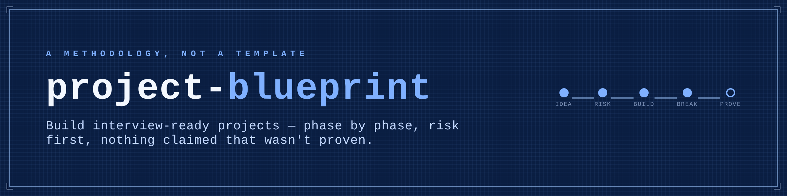

# project-blueprint

**Build interview-ready projects.**

Most "how to build a good portfolio project" advice is generic opinion. This repo isn't that. It's the actual, phase-by-phase pipeline used to build two real, independently verified engineering projects (a flash-sale checkout backend with chaos-tested concurrency, and a data pipeline with chaos-tested correctness) - written down so anyone can follow it, with real worked examples, fillable templates, and nine importable Claude skills covering every step.

The point of a portfolio project isn't that it works. It's that every claim about it is something that was actually proven, not asserted. That's the bar this repo is trying to get you to.

## Quick start

- **Have no idea yet?** Start at [`docs/08_idea_bank.md`](docs/08_idea_bank.md), then run whichever one you pick through [`docs/01_pick_your_idea.md`](docs/01_pick_your_idea.md).
- **Have an idea already?** Start at [`docs/01_pick_your_idea.md`](docs/01_pick_your_idea.md) - check it's not a shallow version of something common before investing time in it.
- **Have a project already, and want to know what's missing?** Jump to [`docs/05_adversarial_testing.md`](docs/05_adversarial_testing.md) and [`docs/06_verification_checklist.md`](docs/06_verification_checklist.md) first - these are usually the actual gap between "it works" and "it's interview-ready." Then [`docs/07_case_study_and_resume.md`](docs/07_case_study_and_resume.md) to write it up.
- **Writing a research paper instead of a project?** [`docs/09_research_paper.md`](docs/09_research_paper.md) applies the same honesty discipline to academic writing.

## The pipeline

Each step below has a doc (the full explanation, with a "step by step, in practice" checklist) and a matching Claude skill (the same guidance, importable on its own).

| Step | Doc | Skill |
|---|---|---|
| Pick your idea | [`docs/01_pick_your_idea.md`](docs/01_pick_your_idea.md) | [`skill/pick-your-idea`](skill/pick-your-idea/SKILL.md) |
| Name your risks | [`docs/02_name_your_risks.md`](docs/02_name_your_risks.md) | [`skill/name-your-risks`](skill/name-your-risks/SKILL.md) |
| Design decisions | [`docs/03_design_decisions.md`](docs/03_design_decisions.md) | *(part of name-your-risks and phased-build)* |
| Build in phases | [`docs/04_build_in_phases.md`](docs/04_build_in_phases.md) | [`skill/phased-build`](skill/phased-build/SKILL.md) |
| Adversarial testing | [`docs/05_adversarial_testing.md`](docs/05_adversarial_testing.md) | [`skill/adversarial-testing`](skill/adversarial-testing/SKILL.md) |
| Verification checklist | [`docs/06_verification_checklist.md`](docs/06_verification_checklist.md) | [`skill/verification-checklist`](skill/verification-checklist/SKILL.md) |
| Case study and resume | [`docs/07_case_study_and_resume.md`](docs/07_case_study_and_resume.md) | [`skill/case-study-and-resume`](skill/case-study-and-resume/SKILL.md) |
| Idea bank | [`docs/08_idea_bank.md`](docs/08_idea_bank.md) | *(reference doc, not a skill)* |
| Research paper drafting | [`docs/09_research_paper.md`](docs/09_research_paper.md) | [`skill/research-paper-drafting`](skill/research-paper-drafting/SKILL.md) |
| Honest documentation (cross-cutting) | *(covered across 06/07)* | [`skill/honest-documentation`](skill/honest-documentation/SKILL.md) |
| **The whole pipeline, as one skill** | - | [`skill/portfolio-project-rigor`](skill/portfolio-project-rigor/SKILL.md) |

Nine skills total, not a round "dozens" for its own sake - each one earns its place by covering a distinct real step, same rule this repo applies to everything else: don't pad for volume.

## What's in this repo

- `docs/` - the methodology itself, one numbered file per step, each ending in a concrete "step by step, in practice" checklist.
- `templates/` - blank, fillable versions of the working documents each step produces (risks, design decisions, adversarial tests, case study).
- `examples/` - real excerpts from two actual projects, annotated to show the methodology in practice, not invented for this repo.
- `skill/` - nine importable Claude skills: one umbrella skill covering the whole pipeline, and eight focused skills for whoever just wants one piece of it.

## How to use the skills

Each `skill/<name>/SKILL.md` is self-contained - copy the folder into wherever your Claude setup reads skills from, or paste its content directly into a conversation. Use `skill/portfolio-project-rigor` if you want the whole pipeline at once; use one of the eight focused skills if you only need help with one step (e.g. just `adversarial-testing` if the project already exists and you want help designing its test suite).

## Why this exists

A project that just "works" and a project that survives a skeptical interviewer asking "how do you know that's true" are different things. The gap between them is almost always: were the real risks named before building, was anything deliberately broken to prove it's handled, and was the result verified independently instead of just trusted. This repo exists to make that gap closeable by anyone, not just something you stumble into after building two projects the hard way.

## License

MIT - see [`LICENSE`](LICENSE). Use, fork, and adapt any of this.
